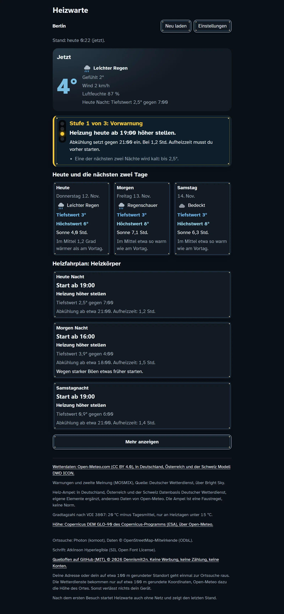

# Heizwarte

Wetter mit Heiz-Ampel. Heizwarte sagt dir, wann du die Heizung hochstellen musst, damit es in der Wohnung warm bleibt, wenn draußen eine kalte Nacht kommt. Gedacht für alle, deren Heizung lange braucht, bis sie warm ist. Werbefrei, ohne Konto, für bis zu fünf Orte.

Live: https://dennismit2n.github.io/heizwarte/ · [English version](README.md)



## Die Heiz-Ampel

Die Ampel schaut auf die nächsten zwei Nächte und hat vier Stufen: Ruhig, Vorwarnung, Heiz-Alarm sowie Frost oder Sturm. Sie sagt dir, ab wann es abkühlt und wann du starten musst, und rechnet dabei mit, wie lange deine Heizung zum Warmwerden braucht. Ein Heizkörper schafft das in einer halben bis zwei Stunden, eine Fußbodenheizung im Estrich braucht 3 bis 6 Stunden. Die Ampel ist eine Faustregel, keine Norm.

## Was noch drin ist

- Fünf Heizarten zur Wahl: Heizkörper, Fußbodenheizung im Estrich, Fußbodenheizung trocken oder dünn, Wärmepumpe mit Fußbodenheizung und Nachtspeicher. Beim Nachtspeicher sagt Heizwarte dir für jeden Abend, wie hoch du aufladen sollst.
- Ein Heizfahrplan für die kommenden Nächte mit Tiefstwert, Beginn der Abkühlung und Startzeit.
- Das Wetter jetzt, dazu heute und die nächsten zwei Tage mit Tiefst- und Höchstwert, Regen, Sonne und Böen.
- Hinter „Mehr anzeigen“ der Temperaturverlauf über 72 Stunden und die beste Zeit zum Stoßlüften gegen Schimmel. Liegt eine Wetterstation in der Nähe, zeigt die Kurve dazu eine zweite Meinung (MOSMIX).
- Warnungen des Deutschen Wetterdienstes für Orte in Deutschland, wörtlich und nicht umformuliert.
- Bis zu fünf Orte, zwischen denen du wechseln kannst.
- Raumtemperatur, Aufheizzeit und Höhe stellst du in den Einstellungen ein. Unter „Für Fortgeschrittene“ kannst du auch die Schwellen ändern, ab denen die Ampel umspringt.
- Darstellung nach Wahl: System, Hell, Dunkel, Hoher Kontrast hell und dunkel, Farbenblind hell und dunkel sowie Umgekehrte Farben.
- Der Knopf „Installieren“ richtet Heizwarte als App ein, wenn dein Browser das kann. Nach dem ersten Besuch startet sie auch ohne Netz und zeigt den letzten Stand.

## Sprachen

Deutsch, Englisch, Spanisch, Französisch, Italienisch, Niederländisch, Polnisch, Portugiesisch, Türkisch, Russisch, Hindi, Chinesisch, Japanisch und Koreanisch. Heizwarte folgt der Sprache deines Browsers, umstellen kannst du sie in den Einstellungen. Ist deine Sprache nicht dabei, startet Heizwarte auf Deutsch. Die Warnungen des Deutschen Wetterdienstes gibt es nur auf Deutsch und Englisch, in den anderen Sprachen steht dort der englische Wortlaut. Die Übersetzungen sind maschinell entstanden, Korrekturen nehme ich gern an.

## Was dein Gerät verlässt

Heizwarte hat keinen eigenen Server. Die Content Security Policy der Seite lässt Verbindungen nur zu drei fremden Adressen zu:

- `api.open-meteo.com` für die Wettervorhersage und die Höhe deines Ortes
- `api.brightsky.dev` für die Warnungen und die zweite Meinung des Deutschen Wetterdienstes
- `photon.komoot.io` für die Ortssuche

Deine Adresse oder dein auf etwa 100 m gerundeter Standort geht einmal an die Ortssuche. Die Wetterdienste bekommen nur auf etwa 100 m gerundete Koordinaten, Open-Meteo dazu die Höhe des Ortes. Sonst verlässt nichts dein Gerät, deine Orte und Einstellungen bleiben im lokalen Speicher deines Browsers. Auch die Schrift liegt mit im Repo und kommt nicht von einem fremden Server. Nachprüfen kannst du das in den Entwicklerwerkzeugen deines Browsers.

## Quellen

- Wetterdaten: Open-Meteo.com (CC BY 4.0), in Deutschland, Österreich und der Schweiz Modell DWD ICON
- Warnungen und zweite Meinung (MOSMIX): Deutscher Wetterdienst, über Bright Sky
- Höhe: Copernicus DEM GLO-90 des Copernicus-Programms (ESA), über Open-Meteo
- Ortssuche: Photon (komoot), Daten © OpenStreetMap-Mitwirkende (ODbL)
- Gradtagzahl nach VDI 3807
- Schrift: Atkinson Hyperlegible (SIL Open Font License)

## Entwicklung

Kein Build-Schritt, die App besteht aus statischen Dateien.

```bash
node tools/dev-server.js
```

Dann http://localhost:8619 öffnen.

```bash
node --test
```

Die Unit-Tests brauchen nur Node. Für die Rauchtests im Browser einmal `npm install` und `npx playwright install chromium`, danach `npx playwright test`. Sie starten den Dev-Server selbst und leiten jede Anfrage auf die Testdaten in `tests/fixtures` um, nach außen geht dabei nichts.

Bei jedem Deploy die Konstante `CACHE` in [sw.js](sw.js) um eins hochzählen und die `?v=`-Stempel in `index.html` erneuern.

## Lizenz

[MIT](LICENSE). Die Schrift steht unter der SIL Open Font License ([assets/fonts/OFL.txt](assets/fonts/OFL.txt)), für die Daten gelten die Lizenzen der Quellen oben.

© 2026 Dennis_mit_2n · Teil der [Werkstatt](https://dennismit2n.github.io/)
