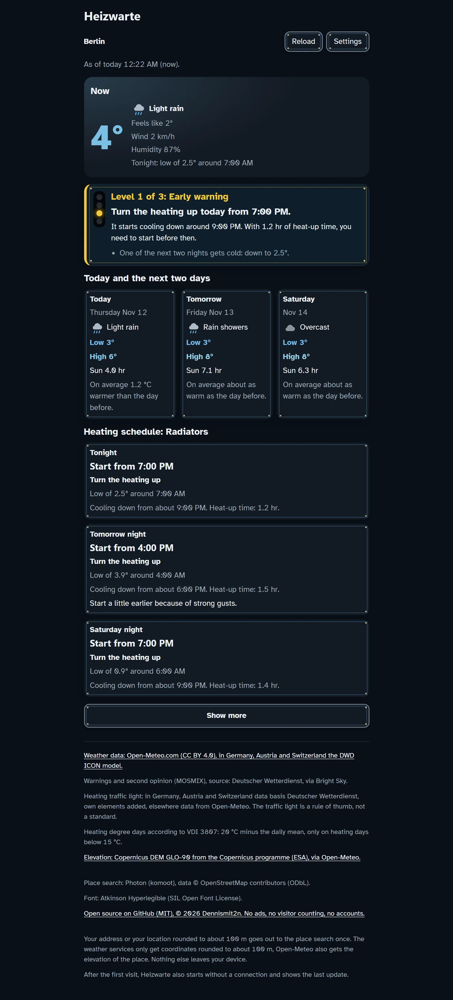

# Heizwarte

Weather with a heating traffic light. Heizwarte tells you when to turn up the heating, so your home stays warm when a cold night is coming. Made for everyone whose heating takes a long time to warm up. No ads, no account, for up to five places.

Live: https://dennismit2n.github.io/heizwarte/ · [Deutsche Fassung](README.de.md)



## The heating traffic light

The traffic light looks at the next two nights and has four levels: “Calm”, “Early warning”, “Heating alert” and “Frost or storm”. It tells you when it starts to cool down and when you need to start, and it takes into account how long your heating needs to warm up. Radiators manage that in half an hour to two hours, underfloor heating in screed takes 3 to 6 hours. The traffic light is a rule of thumb, not a standard.

## What else is in it

- Five heating types to choose from: radiators, underfloor heating in screed, underfloor heating dry or thin, heat pump with underfloor heating, and storage heaters. For storage heaters, Heizwarte tells you for each evening how high to charge them.
- A heating schedule for the coming nights with the low, when it starts to cool down and when to start.
- The weather now, plus today and the next two days with low and high, rain, sun and gusts.
- Behind “Show more”, the temperature over 72 hours and the best time to air out against mould. If there is a weather station nearby, the chart also shows a second opinion (MOSMIX).
- Warnings from Deutscher Wetterdienst (the German weather service) for places in Germany, word for word.
- Up to five places you can switch between.
- Room temperature, heat-up time and elevation are in the settings. Under “For advanced users” you can also change the thresholds at which the traffic light switches.
- Appearance of your choice: System, Light, Dark, High contrast light and dark, Colour-blind light and dark, and Inverted colours.
- The “Install” button sets Heizwarte up as an app if your browser can do that. After the first visit it also starts without a connection and shows the last update.

## Languages

German, English, Spanish, French, Italian, Dutch, Polish, Portuguese, Turkish, Russian, Hindi, Chinese, Japanese and Korean. Heizwarte follows your browser’s language, you can change it in the settings. If your language isn’t one of them, Heizwarte starts in German. Warnings from Deutscher Wetterdienst only come in German and English, in the other languages you see the English wording. The translations are machine-made, I’m happy to take corrections.

## What leaves your device

Heizwarte has no server of its own. The page’s Content Security Policy only allows connections to three outside addresses:

- `api.open-meteo.com` for the forecast and the elevation of your place
- `api.brightsky.dev` for the warnings and the second opinion from Deutscher Wetterdienst
- `photon.komoot.io` for the place search

Your address, or your location rounded to about 100 m, goes to the place search once. The weather services only get coordinates rounded to about 100 m, Open-Meteo also gets the elevation of the place. Nothing else leaves your device, your places and settings stay in your browser’s local storage. The font is in the repo too and doesn’t come from an outside server. You can check all of this in your browser’s developer tools.

## Sources

- Weather data: Open-Meteo.com (CC BY 4.0), in Germany, Austria and Switzerland the DWD ICON model
- Warnings and second opinion (MOSMIX): Deutscher Wetterdienst, via Bright Sky
- Elevation: Copernicus DEM GLO-90 from the Copernicus programme (ESA), via Open-Meteo
- Place search: Photon (komoot), data © OpenStreetMap contributors (ODbL)
- Heating degree days according to VDI 3807
- Font: Atkinson Hyperlegible (SIL Open Font License)

## Development

No build step, the app is just static files.

```bash
node tools/dev-server.js
```

Then open http://localhost:8619.

```bash
node --test
```

The unit tests only need Node. For the smoke tests in the browser, run `npm install` and `npx playwright install chromium` once, then `npx playwright test`. They start the dev server themselves and send every request to the test data in `tests/fixtures`, nothing goes out.

On every deploy, bump the `CACHE` constant in [sw.js](sw.js) by one and renew the `?v=` stamps in `index.html`.

## Licence

[MIT](LICENSE). The font is under the SIL Open Font License ([assets/fonts/OFL.txt](assets/fonts/OFL.txt)), the data falls under the licences of the sources above.

© 2026 Dennis_mit_2n · part of [the workshop](https://dennismit2n.github.io/)
